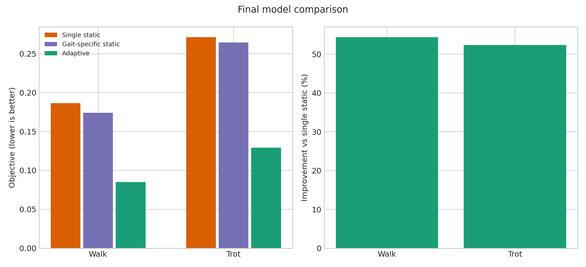
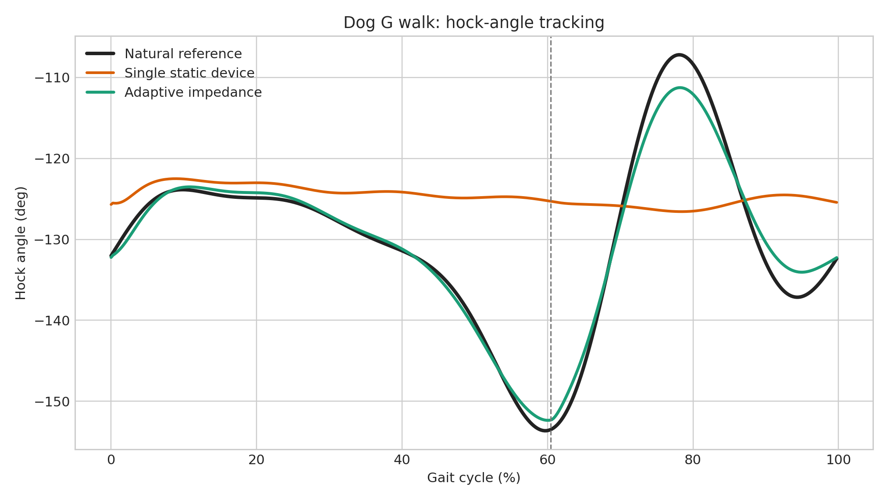

# Vision-Informed Adaptive Canine Hind-Limb Prosthesis

**Bachelor's thesis research · University of Messina · Computational model v3.0**

A subject-specific, reduced-order physics simulation of a below-knee canine hind-limb prosthesis. Vision-derived gait references inform numerical optimization of phase-continuous variable impedance for walking and trotting, with the natural knee preserved.



## Research pipeline

1. Process published motion-derived gait data into phase-normalized kinematic references (101 points per stride).
2. Personalize distal limb geometry, inertia proxies and gait timing for Dog G.
3. Simulate hock and paw dynamics with RK4, compliant contact, actuator lag, rate limits and torque saturation.
4. Optimize equivalent impedance using Latin Hypercube search and coordinate refinement.
5. Compare one common fixed device, gait-specific static baselines and phase-continuous adaptive policies.

The controller uses rotational stiffness K, damping B, equilibrium angle theta_eq and paw compressive stiffness k_paw.

```text
tau = -K(phase) * (theta - theta_eq(phase)) - B(phase) * theta_dot
```

## Reported results

| Metric (reduction vs common fixed device) | Walk | Trot |
|---|---:|---:|
| Weighted objective | 54.4% | 52.3% |
| Hock angle RMSE | 87.1% | 71.7% |
| Toe position RMSE | 68.6% | 57.9% |

Against gait-specific optimized static devices, the objective reduction was approximately 51.1% for both gaits. Some jerk and peak-load error measures worsened. These are original reported simulation results, not independent experimental or clinical validation.



See [final results](FINAL_RESULTS.md), [model assumptions](docs/MODEL_ASSUMPTIONS.md), and [reported metrics](results/csv/summary_metrics.csv).

## Repository structure

- `src/`: dynamic model, reference processing, metrics, control policies, optimization and reproduction scripts
- `config/`: locked model parameters
- `data/`: personalized references and processed stride data
- `results/`: reported numerical results and selected visualizations
- `tests/`: checks of delivered numerical artifacts

## Reproduction

Python with NumPy, pandas, SciPy and Matplotlib. FFmpeg is needed for video generation. Install:

```bash
python -m pip install -r requirements.txt
python src/reproduce_final.py --skip-video
```

To repeat the original optimization, use `python src/run_pipeline.py`. The full reference CSV `data/Canine_Prosthesis_Kinematic_Targets_101.csv` is required for reproduction and held-out stride checks. If absent, obtain the original from the private Drive research archive; do not substitute synthetic data for the reported experiment. The original result-check script `python tests/test_results.py` also expects both delivered gait videos.

## Scientific scope

- 75 strides from six dogs; personalized controller results for Dog G (7 walk, 6 trot strides).
- Prescribed proximal motion; no whole-body dynamic solution.
- Literature-calibrated loading rather than synchronized Dog G force-plate measurements.
- Equivalent/optimal stiffness, not measured biological stiffness.
- Vision is the research/reference layer. The sensor-based TCN is an untrained deployment template; no validated real-time IMU/FSR inference or new end-to-end markerless pose network is claimed.
- No fabricated physical prosthesis or animal trials. This is a computational proof of concept.

## Data and publication

Private research archive migrated from the author's Google Drive. Before public release, verify the source dataset's redistribution terms, university/lab permissions, and any third-party material. No license is assigned here. Earlier iterations and third-party articles remain in the original archive.
